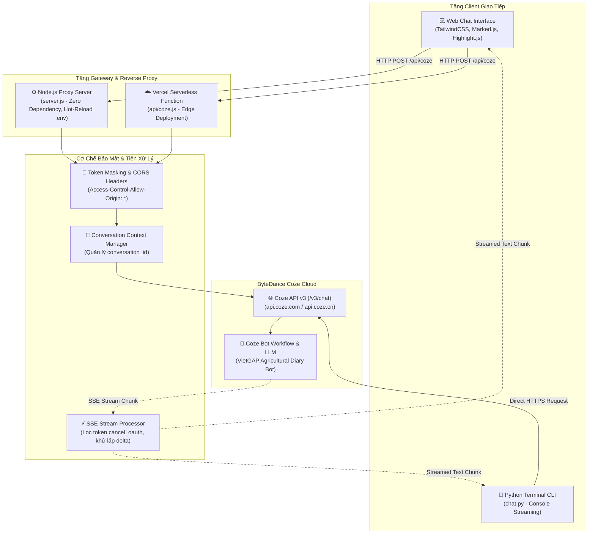

# 🤖 COZE AI AGENT — Web Chat & API Streaming Gateway

<div align="center">


**Giải pháp tích hợp toàn diện ByteDance Coze API v3: Giao diện Web Chat chuẩn tương tác cao, Reverse Proxy chống CORS không phụ thuộc thư viện ngoài (Zero-dependency), Serverless Edge Function và Client Python Terminal cho nghiệp vụ số hóa nhật ký canh tác chuẩn VietGAP.**

*Kỹ sư phát triển: **[Vương Quốc Hòa](https://github.com/VuongQuocHoa)***

</div>

---

## 📖 Giới Thiệu Dự Án

**Coze AI Agent** là hệ sinh thái kết nối và điều phối trí tuệ nhân tạo xây dựng quanh **ByteDance Coze API v3**, giải quyết toàn diện các bài toán thường gặp khi đưa Coze Bot vào ứng dụng thực tế:
- **Khắc phục lỗi CORS & Bảo mật Token:** Xây dựng cổng trung gian Reverse Proxy (cả Node.js thuần và Vercel Serverless Function) giúp che giấu `COZE_API_KEY` ở backend và mở thông kết nối tới mọi client frontend.
- **Truyền tải dòng dữ liệu thời gian thực (SSE Streaming):** Đọc luồng `Server-Sent Events` liên tục, khử nhiễu token trùng lặp (`deduplication`) giữa các sự kiện `conversation.message.delta` và `completed`.
- **Duy trì ngữ cảnh hội thoại đa lượt:** Quản lý `conversation_id` động, đảm bảo bot ghi nhớ trạng thái trao đổi của người dùng xuyên suốt phiên làm việc.
- **Kịch bản nghiệp vụ thực tế (VietGAP Farm Logging):** Tích hợp luồng trò chuyện hướng dẫn người nông dân ghi chép nhật ký nông nghiệp (cây trồng, lô thửa, vật tư, hoạt động canh tác) để chuẩn hóa dữ liệu đầu vào.

---

## 🏛️ Sơ Đồ Kiến Trúc Hệ Thống (Architecture)



---

## ✨ Các Tính Năng Kỹ Thuật Nổi Bật

### 1. 🖥️ Giao Diện Web Chat Hiện Đại (Dark Mode Glassmorphism)
- **Tối ưu trải nghiệm thị giác:** Giao diện tông màu tối công nghệ (`#111216`), sidebar phân chia đoạn chat, hiệu ứng gõ phím mượt mà và tự động cuộn thông minh (`autoScroll`).
- **Xử lý Markdown & Code Syntax Highlighting:** Tích hợp `Marked.js` và `Highlight.js` tự động nhận diện ngôn ngữ lập trình, đi kèm nút sao chép mã nguồn (Copy Code) 1-click.
- **Quản lý đa phiên chat (Multi-session Storage):** Lưu trữ lịch sử trò chuyện trong `LocalStorage`, hỗ trợ tạo đoạn chat mới, đổi tên phiên hội thoại và xóa lịch sử.
- **Modal Cài Đặt Linh Hoạt:** Cho phép người dùng linh hoạt đổi Bot ID / Token cá nhân ngay trên trình duyệt, hoặc ưu tiên dùng cấu hình mặc định từ máy chủ.

### 2. 🛡️ Node.js Proxy Server Siêu Nhẹ (Zero External Dependencies)
- Sử dụng hoàn toàn module lõi của Node.js (`http`, `https`, `fs`, `path`), **không cần cài thêm thư viện npm nặng nề**.
- **Cơ chế Hot-Reload `.env`:** Tự động phát hiện thay đổi trong tệp `.env` dựa trên `fs.statSync(mtimeMs)` và nạp lại cấu hình tức thì mà không cần khởi động lại server.
- **Khử lỗi CORS triệt để:** Cung cấp đầy đủ các headers `Access-Control-Allow-Origin: *` cho cả phương thức `OPTIONS preflight` và `POST`.

### 3. ☁️ Vercel Serverless Function Sẵn Sàng Triển Khai (`api/coze.js`)
- Triển khai dạng Serverless Edge Handler trên Vercel hoặc Render.
- Tự động bắt dòng dữ liệu `Content-Type: text/event-stream` và `pipe` phản hồi về trình duyệt với độ trễ tối thiểu (< 150ms TTFB).

### 4. 🐍 Python CLI Client Độc Lập (`chat.py`)
- Bản chạy 1 tệp duy nhất, chỉ phụ thuộc thư viện `requests`.
- Nạp cấu hình tự động từ `.env`.
- In câu trả lời chạy từng từ (stream) ra terminal qua `sys.stdout.write` và tự động flush bộ đệm.
- Ghi nhớ `conversation_id` để đàm thoại liên tục mà không mất ngữ cảnh câu hỏi trước.

### 5. 🌾 Nghiệp Vụ Chuyên Biệt: Số Hóa Nhật Ký VietGAP
- Cấu hình lời chào và prompt dẫn dắt người dùng ghi chép hoạt động nông nghiệp:
  - Tên cây trồng / Lô đất canh tác
  - Hoạt động canh tác (Bón phân, phun thuốc bảo vệ thực vật, tưới tiêu, thu hoạch)
  - Vật tư sử dụng và liều lượng
  - Người thực hiện
- Chuẩn bị dữ liệu đầu ra có cấu trúc (Structured JSON) để đồng bộ vào cơ sở dữ liệu hoặc Google Sheets.

---

## 📁 Cấu Trúc Thư Mục Dự Án

```
d:\PROJECTS\coze-agent\
├── api/
│   └── coze.js              # Serverless Function proxy cho Vercel (/api/coze)
├── .env.example             # File mẫu cấu hình biến môi trường
├── .gitignore               # Loại bỏ token, môi trường ảo và dependencies
├── app.js                   # Logic ứng dụng frontend (SSE Parser, Markdown, UI State)
├── chat.py                  # Client Python dòng lệnh kết nối Coze API v3 (Streaming)
├── index.html               # Giao diện Web SPA (TailwindCSS, Lucide, Marked, Highlight)
├── package.json             # Cấu hình NPM và lệnh khởi chạy Node.js
├── README.md                # Tài liệu kỹ thuật dự án (English & Vietnamese)
├── requirements.txt         # Thư viện phụ thuộc cho Python (requests)
├── server.js                # Local HTTP Server & CORS Proxy (Node.js thuần, Hot-Reload)
├── style.css                # CSS tinh chỉnh thanh cuộn tùy biến và hiệu ứng tin nhắn
├── test.py                  # Script kiểm tra phản hồi API và Quota Rate-limit
└── vercel.json              # Cấu hình định tuyến và triển khai Serverless trên Vercel
```

---

## 🚀 Hướng Dẫn Cài Đặt & Sử Dụng

### 1. Chuẩn bị biến môi trường
Sao chép file `.env.example` thành `.env`:
```bash
cp .env.example .env
```
Điền các thông tin xác thực từ [Coze Developer Console](https://www.coze.com/open/oauth/pats):
```ini
# Port chạy Web Server cục bộ
PORT=3000

# Token truy cập Coze (Personal Access Token - pat_...)
COZE_API_KEY=pat_your_personal_access_token_here

# ID của Bot trên Coze (chuỗi số dài)
COZE_BOT_ID=7xxxxxxxxxxxxxxxxxx

# Tên miền máy chủ Coze (api.coze.com cho quốc tế hoặc api.coze.cn)
COZE_HOST=api.coze.com
```

---

### 2. Khởi chạy Web Chat Server (Node.js)

Không cần cài đặt thư viện nặng nề, khởi chạy ngay với:
```bash
npm start
# Hoặc: node server.js
```
Mở trình duyệt tại địa chỉ: **[http://localhost:3000](http://localhost:3000)**.

---

### 3. Khởi chạy Terminal Client (Python)

Cài đặt thư viện `requests` (nếu chưa có):
```bash
pip install -r requirements.txt
```
Chạy ứng dụng:
```bash
python chat.py
```
> **Trải nghiệm:** Bot sẽ hiển thị lời chào nghiệp vụ VietGAP và in từng từ câu trả lời theo thời gian thực trực tiếp trên cửa sổ Terminal.

---

### 4. Triển khai lên Vercel (1-Click Deploy)

Dự án đã có sẵn tệp `vercel.json` và thư mục `api/coze.js`.
1. Đẩy mã nguồn lên kho lưu trữ GitHub của bạn.
2. Đăng nhập [Vercel](https://vercel.com), bấm **Add New Project** và chọn kho lưu trữ `coze-agent`.
3. Trong mục **Environment Variables**, cấu hình 2 biến:
   - `COZE_API_KEY`: Token `pat_...`
   - `COZE_BOT_ID`: ID của Bot
4. Nhấn **Deploy**. Sau 30 giây, ứng dụng web của bạn sẽ hoạt động toàn cầu với tên miền `*.vercel.app`!

---

## 🛠️ Chi Tiết Kỹ Thuật: Cơ Chế SSE Deduplication

Khi giao tiếp với Coze API v3 ở chế độ stream (`stream: true`), luồng SSE sẽ bắn ra nhiều loại sự kiện liên tiếp:
1. `conversation.message.delta`: Chứa từng cụm ký tự nội dung mới tạo ra (`content`).
2. `conversation.message.completed`: Bắn lại toàn bộ câu trả lời đã hoàn chỉnh.

Nếu không xử lý deduplication, giao diện sẽ bị nhân đôi hoặc lặp chữ. Trong `app.js` và `chat.py`, thuật toán xử lý luồng được thiết lập:
```javascript
// Chỉ render các khối delta có kiểu 'answer'
if (eventName === 'conversation.message.delta' && msgType === 'answer') {
  let cleanChunk = data.content
    .replace(/cancel_oauth[a-zA-Z0-9_\-]+/g, '')
    .replace(/授权后即代表[^\n]*/g, '');
  
  if (cleanChunk) {
    appendTokenToBubble(cleanChunk);
  }
}
// Bỏ qua sự kiện 'conversation.message.completed' nếu đã render đủ từ delta
```

---

## 👨‍💻 Thông Tin Tác Giả & Bản Quyền

- **Họ và tên:** **Vương Quốc Hòa** (Vuong Quoc Hoa)
- **Vị trí chuyên môn:** Junior AI & Full-Stack Engineer
- **GitHub:** [@VuongQuocHoa](https://github.com/VuongQuocHoa)
- **Email:** `hoalkasd@gmail.com`
- **Portfolio:** [VuongQuocHoa Portfolio](https://github.com/VuongQuocHoa/portfolio)
- **Giấy phép:** [MIT License](LICENSE) — Tự do sử dụng và tích hợp trong các dự án thương mại hoặc học thuật.
